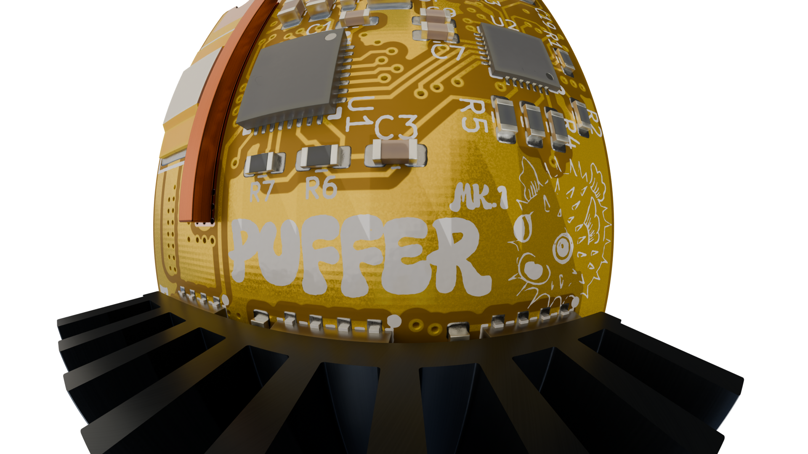
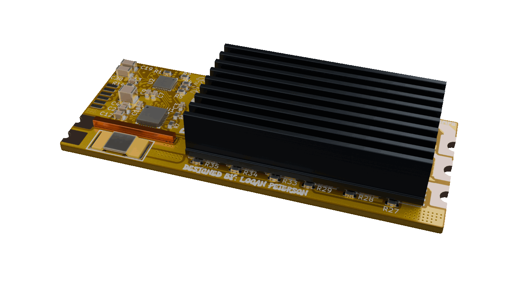
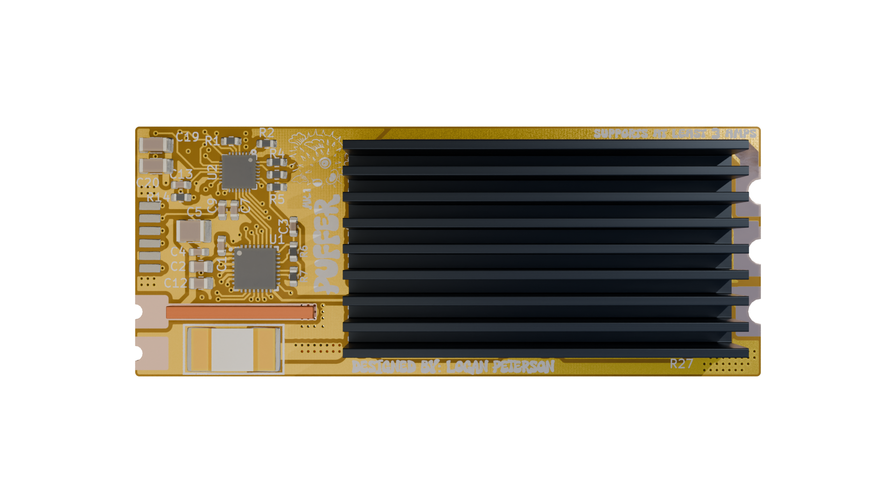
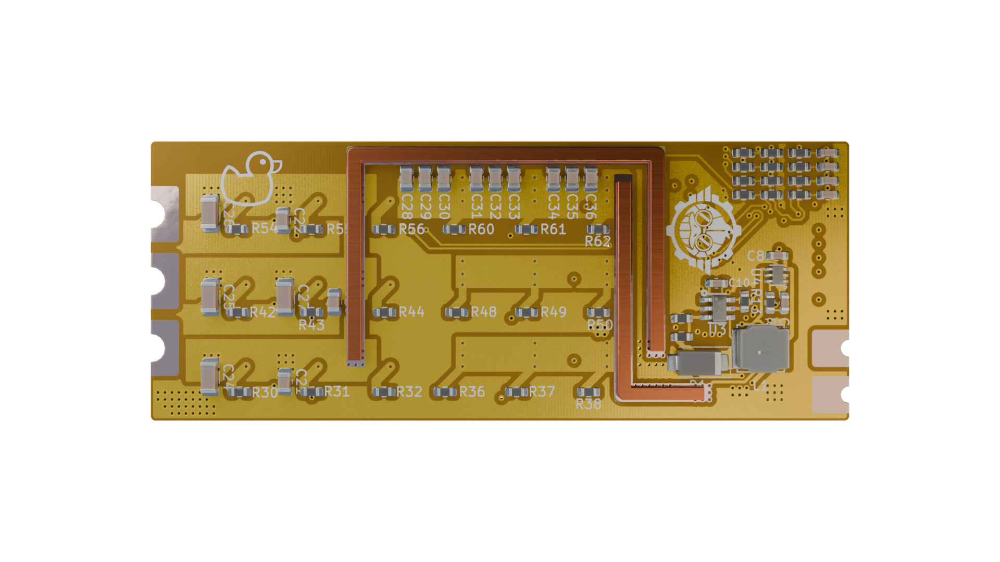

  

# Puffer ESC — A Ridiculous Little Combat Robot ESC

### Named for what it will do to your battery.

Puffer is a compact, three-phase brushless ESC designed to push the limits of current handling in combat robotics.

Rather than using a single MOSFET per switching position, Puffer uses three in parallel, bringing the total to **18 MOSFETs on a 75 × 30 mm PCB**. The goal is to reduce conduction losses and improve current handling without significantly increasing the footprint of the ESC.

Of course, throwing more MOSFETs at the problem doesn't magically make this a 300A ESC. Actual performance will depend on PCB resistance, current sharing, switching losses, and thermal management.

But 18 MOSFETs on a tiny PCB looks ridiculous, and that's reason enough to try it.

> **Where this project is at:** Hardware designed; assembly, firmware development, and performance tests are pending.

## Renders

Because everyone loves eye candy.

  
  
  

## Hardware Specifications

| Specification | Details |
| :--- | :--- |
| Motor Type | Three-phase brushless DC (BLDC) |
| PCB Dimensions | 75 × 30 mm |
| PCB Stackup | 4 layers |
| Microcontroller | AT32F421G8U7 |
| Gate Driver | DRV8320HRTVR |
| MOSFETs | 18 × HYG025N06LS1C2 (60 V) |
| Power Stage | Six switching banks, three MOSFETs per bank |
| Current Sense Amplifier | INA186A2IDCKR |
| Current Shunt | ASR-M-5-0.2F (0.2 mΩ) |
| Temperature Sensor | 10 kΩ NTC thermistor |
| Buck Converter | LMR16006XDDCR |
| Power Distribution | Double-sided copper bus bars |
| DC-Link Filtering | Onboard capacitors |
| Cooling | Aluminum heatsink covering all 18 MOSFETs |
| Continuous Current Rating | TBD — pending testing |
| Peak Current Rating | TBD — pending testing |

The complete bill of materials is available in [BOM.csv](./BOM.csv).

## Next Steps

- Assemble the first boards.
- Develop and tune the motor-control firmware.
- Stress test the power stage.
- Measure maximum sustained and peak current capability.
- Put it in a combat robot and see what happens?

---

## Contributing

Ideas, improvements, design reviews, and constructive roasting are welcome.

Feel free to open an issue or submit a pull request. Feedback on the hardware, firmware, and overall design is appreciated, especially if you've spotted something I've overlooked.

## Disclaimer

Puffer is an experimental, open-source hardware project, not a commercially validated ESC. Its performance, reliability, and operating limits have yet to be established.

Working with high currents, spinning motors, and stored electrical energy carries inherent risks. Exercise appropriate safety precautions when assembling, powering, or testing this hardware.

If you short something or accidentally turn your robot into a very expensive space heater, that's on you.
